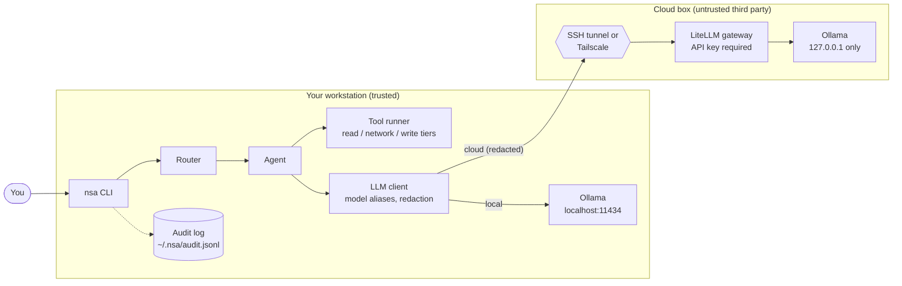
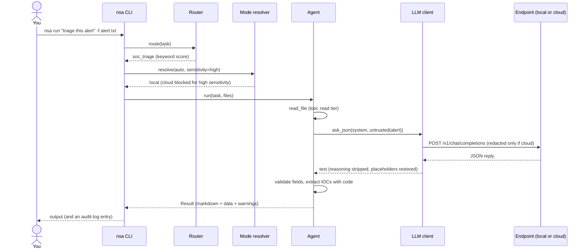
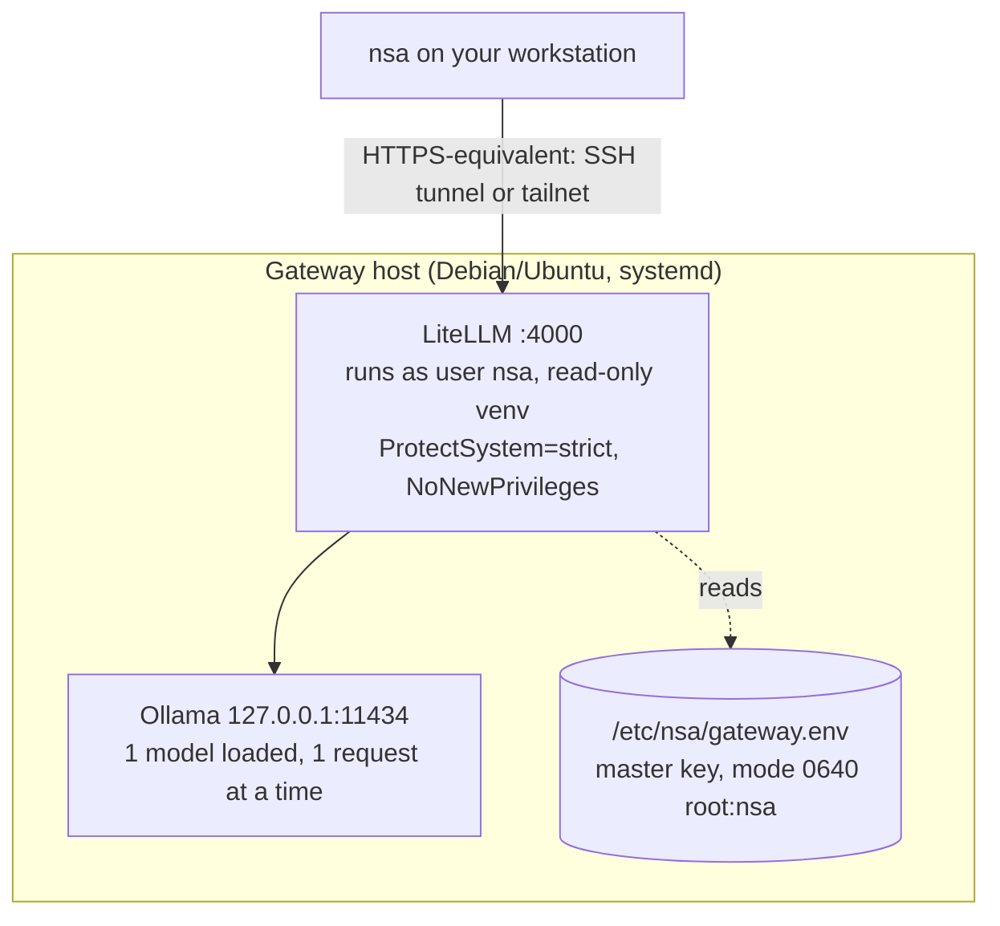

# Architecture

This document explains how NSA is built and why. For setup, start with the [README](../README.md); for the threat model, see [SECURITY.md](SECURITY.md).

## 1. Goals

| Goal | What it means in the design |
|---|---|
| **Local-first** | The default and preferred path is a model running on your own machine. The cloud is an optional second endpoint, never a requirement. |
| **One codebase, two places to run** | Agents are identical in `local` and `cloud` mode. Only the endpoint and the model name change. |
| **Works with small models** | Agents are fixed, bounded pipelines. The model fills narrow steps and returns structured JSON; it never plans open-ended multi-step work. |
| **Secure by construction** | Untrusted input is isolated from tools, facts that must be exact come from code, and anything leaving the machine is gated and redacted. |
| **Disposable infrastructure** | The cloud side holds no state. A new machine plus one script rebuilds it. |

## 2. System overview

Everything in the left box runs on your machine. The right box is a disposable machine you rebuild from [`infra/`](../infra/README.md). Both speak the **OpenAI chat-completions API**, which is why one client class serves both.

## 3. Components

| Module | Responsibility |
|---|---|
| [`nsa/cli.py`](../nsa/cli.py) | Command-line interface: `run`, `route`, `list`, `doctor`, `connect`, `tunnel`. Approval prompts. |
| [`nsa/router.py`](../nsa/router.py) | Picks an agent for a task (keywords first, a local model only if ambiguous). |
| [`nsa/core/registry.py`](../nsa/core/registry.py) | Discovers agents (`agents/*/agent.yaml`), validates manifests, imports entrypoints. |
| [`nsa/core/agent.py`](../nsa/core/agent.py) | `Agent` base class: `ask`, `ask_json` (validated, retried), `untrusted()` wrapper, `paths_from`. |
| [`nsa/core/llm.py`](../nsa/core/llm.py) | `LLMClient` (one class for both modes), endpoint checks, error translation, GPU-offload inspection. |
| [`nsa/core/modes.py`](../nsa/core/modes.py) | Resolves `local` / `cloud` / `auto`, enforces the sensitivity gate. |
| [`nsa/core/redact.py`](../nsa/core/redact.py) | Reversible redaction applied to every cloud prompt. |
| [`nsa/core/tools.py`](../nsa/core/tools.py) | Tool registry, per-agent allowlists, risk tiers, approvals. |
| [`nsa/tools/builtin.py`](../nsa/tools/builtin.py) | The five built-in tools with their guards (path roots, SSRF block, size caps). |
| [`nsa/tools/ioc.py`](../nsa/tools/ioc.py), [`sigma.py`](../nsa/tools/sigma.py) | Deterministic IOC extraction; Sigma parse, validate and a small matcher. |
| [`nsa/core/audit.py`](../nsa/core/audit.py) | Append-only JSONL audit log of metadata, never content. |
| [`nsa/core/config.py`](../nsa/core/config.py) | YAML + `.env` loading with `${VAR:-default}` expansion; atomic `.env` writer. |

## 4. Life of a request

1. **Route.** If you did not pass `--agent`, the router scores the task against every agent.
2. **Resolve the mode.** `local`, `cloud` or `auto`, combined with the agent's sensitivity, gives the endpoint. Failing safe is the rule: if no permitted endpoint exists, the command errors rather than falling back to something less safe.
3. **Run the agent.** The agent's pipeline calls tools (allowlisted per agent) and the model (through the alias it declares).
4. **Validate.** Model output is parsed and checked; invalid values are corrected and flagged as warnings; exact facts (IOCs, rule syntax) come from code.
5. **Audit.** Metadata about the run, each model call and each tool call is appended to the audit log.

## 5. Modes and the sensitivity gate

Each agent declares `sensitivity: low | medium | high`. `high` means "its inputs are the kind of data that must not leave the machine by default".

| Requested | Agent sensitivity | Result |
|---|---|---|
| `local` | any | local endpoint |
| `cloud` | low / medium | cloud endpoint (prompts redacted), error if no cloud configured |
| `cloud` | **high** | **refused** unless `--allow-sensitive-cloud` (then cloud, still redacted) |
| `auto` | any | local if its `/models` answers, otherwise cloud *if the agent may use it*, otherwise an error |

`auto` never "falls back" a high-sensitivity agent to the cloud. Routing itself (choosing the agent) only ever talks to the **local** model, so a task description is not sent to the cloud just to decide which agent should handle it.

## 6. Routing

Stage 1 is free and deterministic ([`router.py`](../nsa/router.py)). For each specialist agent:

- each **keyword** in its manifest that appears in the task scores 3 (a single word, matched after simple stemming), 4 (a phrase or hyphenated term), or 3 (a file-extension hint such as `.tf`);
- every distinctive word shared with the agent's `description` adds 0.5.

The fallback agent (`assistant`) does **not** compete on keywords; it is what you get when no specialist matches.

| Situation | Outcome |
|---|---|
| top score ≥ 3.0 **and** ≥ 1.8× the runner-up | chosen by keyword, no model call |
| otherwise, a local model is reachable | stage 2: the `fast` model picks among the top candidates and returns `{"agent", "confidence"}`; confidence < 0.6 asks you to confirm |
| no model, or the answer is unusable | the top keyword match (asks to confirm) or the fallback agent |

`nsa route "..."` shows the scores and the reason without running anything.

## 7. Model aliases

Agents never contain a model name. They request an alias (`main`, `fast`), and [`config/models.yaml`](../config/models.yaml) maps `alias × mode → real model`. Moving to bigger hardware is therefore a configuration change: edit the names (or the `NSA_MODEL_*` variables) and nothing else.

Two properties matter in practice and are configurable **per alias and per mode**:

- **`reasoning_effort`.** Some models reason in hidden tokens before answering. Where the model supports toggling this (for example `qwen3:8b`), `none` makes calls much faster. For a *thinking-only* model it cannot be turned off, and sending `none` makes the raw reasoning leak into the answer. See [CONFIGURATION.md](CONFIGURATION.md#reasoning-and-token-budget).
- **`max_tokens`.** Hidden reasoning counts against this budget. If a reasoning model spends all of it thinking, the reply is empty; `LLMClient` turns that into an explicit error instead of returning an empty string.

## 8. How agents are built

All six agents follow the same rules (details in [AGENTS.md](AGENTS.md)):

1. **Fixed pipelines, small steps.** Each step has one job and a defined output shape. An 8B (or 4B) model is dependable at "summarise this alert as JSON" and unreliable at "figure out what to do next".
2. **Reader / actor separation.** Attacker-influenced text (alerts, web pages, reports) is wrapped in `<untrusted_data>` and only ever given to a *reader* step that has no tools. Tools are used in code, between model calls.
3. **Facts from code.** Hashes, IPs, domains, rule syntax and ATT&CK ID *format* are extracted or validated deterministically; the model is never trusted to copy them.
4. **Structured output with repair.** `ask_json` requires specific keys, shows the model its own error once, and raises `AgentError` rather than guessing.
5. **Honest output.** Advisory results are labelled as such, model-suggested ATT&CK IDs are labelled "verify", and a Sigma rule that fails its own self-test is returned *with a warning*, not silently.

## 9. Tools and risk tiers

Five built-in tools, each with a fixed risk tier and a per-agent allowlist ([`tools.py`](../nsa/core/tools.py)):

| Tool | Tier | Guard |
|---|---|---|
| `read_file`, `list_dir`, `run_scanner` | read | paths confined to the current directory (+ `NSA_ALLOWED_PATHS`); text only, ≤ 1 MB; scanners are an allowlist run with fixed argv and no shell |
| `fetch_url` | network | `--yes` or an interactive "y"; blocks private, loopback, link-local and reserved addresses; ≤ 500 KB |
| `write_file` | write | always asks; only under `./nsa_out` (or `NSA_OUT`); relative paths without `..`; ≤ 1 MB |

A tool outside the agent's allowlist, or one not approved, raises `ToolDenied`.

## 10. The cloud side

- **One network-facing service.** Ollama listens on localhost only; LiteLLM is the only thing a client can reach, and it requires the generated key.
- **Binds narrowly.** Either the Tailscale IP (`NSA_EXPOSE=tailscale`) or `127.0.0.1` (`NSA_EXPOSE=localhost`, reached through an SSH tunnel). Never `0.0.0.0`.
- **Stateless.** Config lives in git; models are re-downloadable. Rebuild = run the installer on a new machine. See [DEPLOYMENT.md](DEPLOYMENT.md).

## 11. Configuration and state

- **Precedence:** real environment variables > `.env` (loaded without overriding) > defaults inside the YAML files (`${VAR:-default}`).
- **On disk:** `.env` (your settings, mode 600, git-ignored), `~/.nsa/audit.jsonl` (the audit log), `./nsa_out/` (artifacts you approved). There is no database and no background daemon on the client.

## 12. Design decisions and what real hardware taught us

These shaped the current design; they are recorded because each was a surprise.

| Observation | Decision |
|---|---|
| Ollama fell back to CPU without any warning when its CUDA library was unreadable or truncated (calls took minutes). | `nsa doctor --warm` loads the model and reports MB in VRAM; installers repair permissions. |
| On current Ollama, `/no_think` no longer disables Qwen3 reasoning, and hidden reasoning consumed the whole `max_tokens`, giving empty replies. | `reasoning_effort` is a config key per alias and mode; empty replies are an explicit error; the default token budget is 4096. |
| `qwen3:4b` is a thinking-only model: `reasoning_effort: none` leaks its reasoning into the answer, and the default exhausted 4096 tokens on a triage task. | The cloud default is `qwen3:4b-instruct` (no reasoning). The smoke test fails if a one-word reply is long. |
| LiteLLM without a database rejects bad keys with HTTP 500 / 400 rather than 401. | Auth failures are recognised by shape; `verify.sh` tests "was it rejected", not "was it 401". |
| LiteLLM needs ~20 s to initialise after a restart. | The installer waits for the gateway before verifying. |
| A re-run of the installer failed its own disk check because the stack had already used the space. | A box that already has the stack needs only a small margin. |
| `ollama pull` writes thousands of progress lines. | Output is filtered to one line per layer. |

## 13. Extending

- **New agent:** drop a folder in `agents/` with an `agent.yaml` (and optionally `agent.py`). See [AGENTS.md](AGENTS.md#writing-your-own-agent).
- **New tool:** add a function with `@tool("name", risk=...)` in [`nsa/tools/builtin.py`](../nsa/tools/builtin.py) and list it in an agent's `tools`.
- **Different model server:** anything that speaks the OpenAI chat-completions API (`/v1/chat/completions`, `/v1/models`) works as `local` or `cloud`: set the URL in `.env`.
